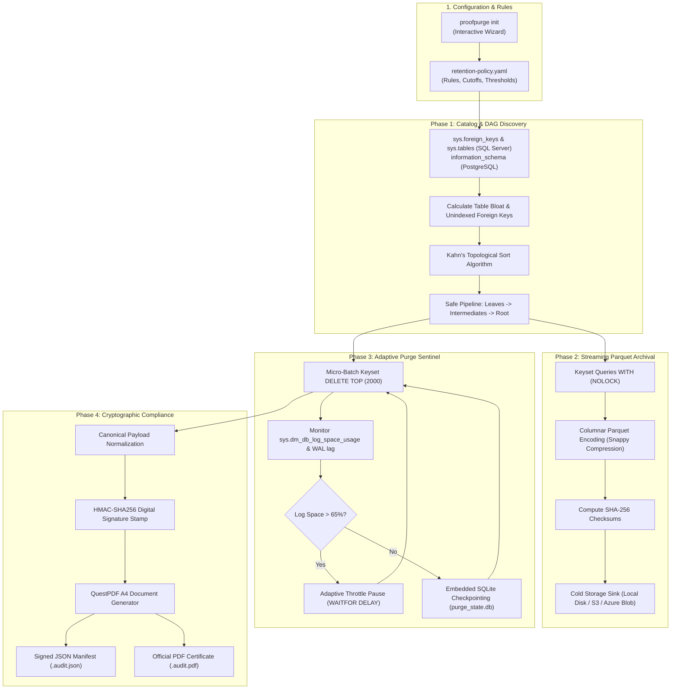

# ProofPurge: Complete System Architecture & Operator Manual

> **Autonomous, Zero-Downtime Relational Database Archiving, Foreign-Key Cascade Purging, and Cryptographic Compliance Engine for SQL Server and PostgreSQL.**

---

## 📑 Table of Contents

1. [Executive Summary & Core Value Proposition](#1-executive-summary--core-value-proposition)
2. [End-to-End System Architecture (Mermaid Diagram)](#2-end-to-end-system-architecture)
3. [Five Core Engineering Modules](#3-five-core-engineering-modules)
   - [Phase 1: Metadata Catalog Inspector & DAG Solver](#phase-1-metadata-catalog-inspector--dag-dependency-solver)
   - [Phase 2: Streaming Columnar Keyset Archiver & 1-Click Restore](#phase-2-streaming-columnar-keyset-archiver--1-click-restore)
   - [Phase 3: Adaptive Zero-Lock Purge Sentinel & Checkpointing](#phase-3-adaptive-zero-lock-purge-sentinel--checkpointing)
   - [Phase 4: Cryptographic Compliance & QuestPDF Certification](#phase-4-cryptographic-compliance--questpdf-certification)
   - [Phase 5: Multi-Cloud Sinks, PostgreSQL Adapter & Production Hardening](#phase-5-multi-cloud-sinks-postgresql-adapter--production-hardening)
4. [Interactive Setup & Retention Rule Configuration](#4-interactive-setup--retention-rule-configuration)
   - [CLI Interactive Setup Wizard (`proofpurge init`)](#cli-interactive-setup-wizard-proofpurge-init)
   - [Declarative YAML Schema (`retention-policy.yaml`)](#declarative-yaml-schema-retention-policyyaml)
   - [Retention Cutoffs, Timestamp Columns & Filter Predicates](#retention-cutoffs-timestamp-columns--filter-predicates)
   - [Environment Variable Expansion & Security Matrix](#environment-variable-expansion--security-matrix)
5. [Complete CLI Reference (All 6 Commands)](#5-complete-cli-reference-all-6-commands)
6. [Operator Manual & QA Testing Playbook](#6-operator-manual--qa-testing-playbook)
   - [Test Fixture Baseline (40,000 Seeded Rows)](#test-fixture-baseline-40000-seeded-rows)
   - [Step-by-Step QA Verification Suite (TC-01 to TC-08)](#step-by-step-qa-verification-suite-tc-01-to-tc-08)
   - [Negative Tamper-Detection Testing](#negative-tamper-detection-testing)
7. [Enterprise Automation & Production Deployment](#7-enterprise-automation--production-deployment)
   - [Docker Containerization](#docker-containerization)
   - [Kubernetes Scheduled CronJob](#kubernetes-scheduled-cronjob)
   - [Windows Task Scheduler & Linux Cron](#windows-task-scheduler--linux-cron)
8. [Commercialization, Pricing & Product Positioning](#8-commercialization-pricing--product-positioning)
9. [Automated Test Suite & GitHub Actions CI](#9-automated-test-suite--github-actions-ci)

---

## 1. Executive Summary & Core Value Proposition

Enterprises running high-volume transactional databases (SQL Server, PostgreSQL) accumulate massive historical tables (orders, order items, audit logs, ledger entries, shipment records) across deeply nested relational hierarchies. 

Retaining millions of obsolete records in primary transactional storage introduces severe hazards:
* **Runaway Cloud Costs:** High provisioned IOPS and expensive Tier-1 storage ($/GB/month on AWS RDS, Azure SQL, or Google Cloud SQL) wasted on inactive data.
* **Degraded Application Latencies:** Buffer pool cache pollution, bloated indexes, and slow query executions.
* **Backup & Recovery Bottlenecks:** Multi-hour backup windows, prolonged point-in-time recovery (PITR), and maintenance window timeouts.
* **Severe Regulatory Exposure:** Massive fines under the **GDPR (Article 17 "Right to Erasure")**, **India DPDP Act 2023 (Section 12 "Data Principal Erasure Rights")**, and **HIPAA Safe Harbor**.

### Why Naive Purging Fails
1. **Lock Escalation & Deadlocks:** Running `DELETE FROM Orders WHERE CreatedAt < ...` locks pages or entire tables, blocking concurrent users and bringing down web applications.
2. **Transaction Log Exhaustion:** Bulk deletes overwhelm transaction logs (`.ldf` in SQL Server, WAL in PostgreSQL), throwing out-of-disk errors (SQL Error 9002) and stalling the database engine.
3. **Foreign Key Constraint Violations:** Deleting parent records fails immediately due to active child dependencies.
4. **Permanent Data Loss Risk:** Purging without verified cold storage archival leaves no recourse if historical data is needed for audits or legal inquiries.

### The ProofPurge Solution
**ProofPurge** provides a self-hosted, lightweight, zero-downtime lifecycle engine that:
1. **Auto-Discovers Schema Hierarchies:** Resolves complex multi-level DAGs via Kahn's algorithm and enforces strict Leaf-to-Root deletion order.
2. **Compresses & Cold-Archives into Parquet:** Saves 85–92% storage footprint before any row is purged, with write-time SHA-256 integrity checksums and 1-click reverse restore.
3. **Guarantees Zero-Lock Execution:** Executes micro-batched deletions (e.g. 2,000 rows) with row-level locks and pauses automatically if transaction log space exceeds safety thresholds (e.g. 65%).
4. **Issues Legal Compliance Certificates:** Generates tamper-evident, digitally signed (HMAC-SHA256) JSON manifests and professional QuestPDF certificates proving compliance for auditors and legal teams.

---

## 2. End-to-End System Architecture



---

## 3. Five Core Engineering Modules

### Phase 1: Metadata Catalog Inspector & DAG Dependency Solver
* **Assemblies:** `DataLifecycleEngine.Catalog`, `DataLifecycleEngine.Core`
* **Key Components:** [SqlServerCatalogInspector.cs](file:///d:/AntiGravity/Project%20DB/src/DataLifecycleEngine.Catalog/SqlServerCatalogInspector.cs), [PostgresCatalogInspector.cs](file:///d:/AntiGravity/Project%20DB/src/DataLifecycleEngine.Catalog/PostgresCatalogInspector.cs), [TopologicalSorter.cs](file:///d:/AntiGravity/Project%20DB/src/DataLifecycleEngine.Core/Graph/TopologicalSorter.cs)
* **Functionality:**
  * Queries database metadata (`sys.foreign_keys`, `sys.foreign_key_columns`, `sys.tables`, `sys.partitions`, `sys.allocation_units`).
  * Evaluates table bloat, estimated rows, and data/index storage allocations.
  * Scans for missing indexes on foreign key columns and flags warnings to prevent full table scans.
  * Solves foreign-key graph cycles and outputs the strict topological deletion order using **Kahn's Algorithm**:
    $$\text{Order: Leaf Tables (OrderItems, Shipments)} \longrightarrow \text{Intermediate (Orders, AuditLogs)} \longrightarrow \text{Root (Accounts)}$$

### Phase 2: Streaming Columnar Keyset Archiver & 1-Click Restore
* **Assembly:** `DataLifecycleEngine.Archiver`
* **Key Components:** [ParquetArchiver.cs](file:///d:/AntiGravity/Project%20DB/src/DataLifecycleEngine.Archiver/ParquetArchiver.cs), [CascadeArchiver.cs](file:///d:/AntiGravity/Project%20DB/src/DataLifecycleEngine.Archiver/CascadeArchiver.cs), [ParquetRestorer.cs](file:///d:/AntiGravity/Project%20DB/src/DataLifecycleEngine.Archiver/ParquetRestorer.cs), [LocalStorageSink.cs](file:///d:/AntiGravity/Project%20DB/src/DataLifecycleEngine.Archiver/Storage/LocalStorageSink.cs)
* **Functionality:**
  * Extracts candidate rowsets using keyset subqueries with `WITH (NOLOCK)` without blocking production traffic.
  * Maps relational data types dynamically into typed Apache Parquet schemas using **Snappy compression** (achieving 85% to 92% storage savings).
  * Computes write-time SHA-256 integrity checksums for every archive file.
  * Provides a 1-click reverse restore engine (`proofpurge restore`) using `SqlBulkCopy` with identity preservation (`KeepIdentity = true`).

### Phase 3: Adaptive Zero-Lock Purge Sentinel & Checkpointing
* **Assembly:** `DataLifecycleEngine.Purger`
* **Key Components:** [AdaptiveCascadePurger.cs](file:///d:/AntiGravity/Project%20DB/src/DataLifecycleEngine.Purger/AdaptiveCascadePurger.cs), [SqlServerVitalsMonitor.cs](file:///d:/AntiGravity/Project%20DB/src/DataLifecycleEngine.Purger/SqlServerVitalsMonitor.cs), [PostgresVitalsMonitor.cs](file:///d:/AntiGravity/Project%20DB/src/DataLifecycleEngine.Purger/PostgresVitalsMonitor.cs), [SqliteCheckpointStore.cs](file:///d:/AntiGravity/Project%20DB/src/DataLifecycleEngine.Purger/SqliteCheckpointStore.cs)
* **Functionality:**
  * Executes micro-batched deletions (`DELETE TOP (@BatchSize) WITH (ROWLOCK)`) in strict reverse topological order.
  * Monitors `sys.dm_db_log_space_usage` and active transactions in real-time. If log utilization exceeds `MaxTransactionLogPercent` (e.g. 65%), it triggers an automatic pause (`ThrottlePauseMs`) to allow log truncation.
  * Maintains atomic checkpoints in embedded SQLite (`checkpoints/purge_state.db`).
  * Catches `SIGINT` / `Ctrl+C` gracefully, finishes the active micro-batch, commits state, and supports `--resume`.

### Phase 4: Cryptographic Compliance & QuestPDF Certification
* **Assembly:** `DataLifecycleEngine.Audit`
* **Key Components:** [AuditCertificateService.cs](file:///d:/AntiGravity/Project%20DB/src/DataLifecycleEngine.Audit/AuditCertificateService.cs), [AuditCryptographer.cs](file:///d:/AntiGravity/Project%20DB/src/DataLifecycleEngine.Audit/Cryptography/AuditCryptographer.cs), [PdfCertificateGenerator.cs](file:///d:/AntiGravity/Project%20DB/src/DataLifecycleEngine.Audit/Generators/PdfCertificateGenerator.cs), [JsonCertificateGenerator.cs](file:///d:/AntiGravity/Project%20DB/src/DataLifecycleEngine.Audit/Generators/JsonCertificateGenerator.cs)
* **Functionality:**
  * Normalizes audit data into a canonical payload string.
  * Signs payload digests using enterprise **HMAC-SHA256** digital signatures.
  * Generates professional A4 compliance certificates via **QuestPDF** displaying verification badges, operator details, metadata cards, storage savings metrics, per-table manifests, cryptographic seal boxes, and statutory compliance declarations.
  * Emits machine-readable JSON manifests (`.audit.json`).
  * Performs bi-directional tamper verification (`proofpurge certify --verify <cert.json>`) checking payload integrity, digital signatures, and live disk file checksums.

### Phase 5: Multi-Cloud Sinks, PostgreSQL Adapter & Production Hardening
* **Assemblies:** `DataLifecycleEngine.Archiver`, `DataLifecycleEngine.Catalog`, `DataLifecycleEngine.Purger`
* **Key Components:** [StorageSinkFactory.cs](file:///d:/AntiGravity/Project%20DB/src/DataLifecycleEngine.Archiver/Storage/StorageSinkFactory.cs), [PostgresCatalogInspector.cs](file:///d:/AntiGravity/Project%20DB/src/DataLifecycleEngine.Catalog/PostgresCatalogInspector.cs), [PostgresVitalsMonitor.cs](file:///d:/AntiGravity/Project%20DB/src/DataLifecycleEngine.Purger/PostgresVitalsMonitor.cs), [Dockerfile](file:///d:/AntiGravity/Project%20DB/Dockerfile), [.github/workflows/build-and-test.yml](file:///d:/AntiGravity/Project%20DB/.github/workflows/build-and-test.yml)
* **Functionality:**
  * Multi-cloud storage sink factory resolving local, S3, and Azure Blob storage paths.
  * Full PostgreSQL adapter querying `information_schema` and monitoring replication lag via `pg_stat_replication`.
  * Container packaging with multi-stage `Dockerfile`.
  * Automated GitHub Actions CI/CD matrix across Ubuntu and Windows.

---

## 4. Interactive Setup & Retention Rule Configuration

### CLI Interactive Setup Wizard (`proofpurge init`)
Instead of manually writing YAML files, users can launch an interactive step-by-step CLI prompt wizard:

```powershell
proofpurge init -o retention-policy.yaml
```

```text
── Interactive Step-by-Step Configuration Wizard ───────────────────────────

1. Select Target Database Engine:
   > sqlserver
     postgres

2. Enter Database Connection String (or ${ENV_VAR}):
   [Server=.\SQLEXPRESS;Database=LifecycleDemo;Trusted_Connection=True;TrustServerCertificate=True;]

3. Policy Name:
   [purge_inactive_records]

4. Root Target Table (Parent table to inspect & purge):
   [Accounts]

5. Date/Timestamp Column to check for age:
   [LastActivityDate]

6. Retention Cutoff Window (e.g. 30d, 90d, 12m, 3y, 7y):
   [3y]

7. Filter Condition (WHERE clause, or press Enter for empty):
   [Status = 'CLOSED']

8. Default Purge Action:
   > archive_and_purge
     dry_run
     archive_only

9. Cold Storage Sink for Parquet Files:
   > local
     s3
     azure
```

The wizard automatically formats, escapes backslashes, validates, and saves the configuration.

---

### Declarative YAML Schema (`retention-policy.yaml`)

```yaml
version: "1.0"

# Target Database Connection
target_database:
  driver: "sqlserver" # 'sqlserver' or 'postgres'
  connection_string: "${DB_CONNECTION_STRING}" # Direct or environment variable

# Cold Storage Sink
storage_sink:
  type: "local" # 'local', 's3', or 'azure'
  local_path: "./archives"
  compression: "snappy" # 'snappy', 'zstd', or 'gzip'

# Zero-Lock Safety Guardrails
safety_thresholds:
  max_batch_size: 2000
  throttle_pause_ms: 1000
  max_transaction_log_percent: 65.0
  max_replication_lag_seconds: 3

# Data Lifecycle Retention Policies
policies:
  - name: "purge_inactive_accounts_and_orders"
    description: "Archive and safely purge records inactive for > 3 years"
    root_table: "Accounts"
    retention_cutoff: "3y"
    date_column: "LastActivityDate"
    where_clause: "Status = 'CLOSED'"
    action: "archive_and_purge" # dry_run | archive_only | archive_and_purge

    # Cascade foreign-key child tables (Leaf-to-Root resolution)
    cascade_children:
      - table: "Orders"
        foreign_key: "AccountId"
        children:
          - table: "OrderItems"
            foreign_key: "OrderId"
          - table: "Shipments"
            foreign_key: "OrderId"
      - table: "AuditLogs"
        foreign_key: "AccountId"
```

---

### Retention Cutoffs, Timestamp Columns & Filter Predicates

#### 1. `retention_cutoff`: How Old Records Must Be
* **Days:** `30d`, `60d`, `90d`, `180d` (Calculates `DATEADD(day, -N, GETUTCDATE())`).
* **Months:** `6m`, `12m`, `18m` (Calculates `DATEADD(month, -N, GETUTCDATE())`).
* **Years:** `1y`, `3y`, `5y`, `7y` (Calculates `DATEADD(year, -N, GETUTCDATE())`).

#### 2. `date_column`: Timestamp Identifier
* Specify any valid date, datetime, or datetime2 column on the root table (e.g. `CreatedAt`, `LastActivityDate`, `OrderDate`, `EventTimestamp`).

#### 3. `where_clause`: Custom Business Predicate
* `where_clause: "Status = 'CLOSED'"` (Inactive accounts).
* `where_clause: "PaymentStatus = 'SETTLED' AND OrderStatus = 'DELIVERED'"` (Fulfilled transactions).
* `where_clause: "IsDeleted = 1"` (Soft-deleted records).
* `where_clause: ""` (Leave empty to purge **all** records older than cutoff).

---

### Environment Variable Expansion & Security Matrix

For enterprise deployments (Docker, Kubernetes, CI/CD), credentials should never be hardcoded into YAML files. ProofPurge automatically expands `${ENV_VAR}` syntax at runtime:

```powershell
$env:DB_CONNECTION_STRING = "Server=10.0.0.5;Database=EnterpriseDB;User Id=purger;Password=SecretPassword123;"
proofpurge scan -c retention-policy.yaml
```

#### Minimum Required Database Permissions:
* **Read-Only Commands (`scan`, `archive`):** Requires `db_datareader` + `VIEW SERVER STATE` (or `VIEW DATABASE STATE`).
* **Purge Execution (`purge`):** Requires `db_datareader` + `DELETE` permission on the targeted cascade tables + `VIEW DATABASE STATE`.
* **Zero Admin Requirement:** Does **NOT** require `sysadmin` or `db_owner` permissions.

---

## 5. Complete CLI Reference (All 6 Commands)

The CLI executable `proofpurge` provides six subcommands:

```text
USAGE:
    proofpurge [COMMAND] [OPTIONS]

COMMANDS:
    init       Initializes a new retention-policy YAML configuration file (Interactive Wizard).
    scan       Scans the database schema, validates foreign keys, and computes safe topological deletion order.
    archive    Extracts historical candidate records across cascade tables and streams them into compressed Parquet.
    restore    Restores archived records from a Parquet file back into the database using SqlBulkCopy.
    purge      Executes zero-lock, micro-batched cascade deletions with real-time transaction log monitoring.
    certify    Issues cryptographically signed compliance audit certificates (PDF/JSON) and verifies tamper-evidence.
```

### Command Flags Breakdown:

| Command | Option / Flag | Description | Default |
| :--- | :--- | :--- | :--- |
| **`init`** | `-o, --output <PATH>` | Output destination for the YAML configuration. | `retention-policy.yaml` |
| | `-q, --quick` | Quick non-interactive scaffold with default placeholders. | `false` |
| | `-f, --force` | Overwrite existing configuration file without prompting. | `false` |
| **`scan`** | `-c, --config <PATH>` | Path to the retention-policy YAML configuration file. | `configs/retention-policy.example.yaml` |
| **`archive`**| `-c, --config <PATH>` | Path to configuration file. | `configs/retention-policy.example.yaml` |
| | `--certify` | Automatically issue signed compliance certificates upon archival completion. | `false` |
| **`restore`**| `-f, --file <PATH>` | Path to source Parquet archive file to restore. | *(Required)* |
| | `-t, --table <NAME>` | Destination table name in the relational database. | *(Required)* |
| | `-c, --config <PATH>` | Path to configuration file. | `configs/retention-policy.example.yaml` |
| **`purge`**  | `-c, --config <PATH>` | Path to configuration file. | `configs/retention-policy.example.yaml` |
| | `--dry-run` | Simulate cascade purge without deleting any database records. | `false` |
| | `--live` | Force live micro-batch deletion execution. | `false` |
| | `--force` | Bypass interactive confirmation prompt. | `false` |
| | `--resume` | Resume an interrupted purge from the last SQLite checkpoint. | `false` |
| | `--batch-size <N>` | Override micro-batch deletion chunk size. | `2000` |
| | `--certify` | Automatically generate signed JSON and PDF compliance certificates. | `false` |
| **`certify`**| `-c, --config <PATH>` | Path to configuration file. | `configs/retention-policy.example.yaml` |
| | `-o, --output <DIR>` | Output directory for generated certificates. | `./audit-certificates` |
| | `--verify <PATH>` | Verify cryptographic authenticity and archive file integrity. | `null` |
| | `--key <SECRET>` | Custom secret key for HMAC-SHA256 signature verification. | *(Default Master Key)* |

---

## 6. Operator Manual & QA Testing Playbook

### Test Fixture Baseline (40,000 Seeded Rows)

Re-seed the test database `LifecycleDemo` with the provided high-speed set-based fixture:

```powershell
sqlcmd -S ".\SQLEXPRESS" -i test/fixtures/sqlserver-schema.sql
```

#### Population Breakdown:
* **`Accounts` (Root):** 5,000 total rows (2,500 `CLOSED` older than 3 years + 2,500 `ACTIVE`).
* **`Orders` (Level 1):** 10,000 total rows (5,000 linked to eligible accounts).
* **`AuditLogs` (Level 1):** 5,000 total rows (2,500 linked to eligible accounts — deliberately unindexed).
* **`OrderItems` (Level 2):** 10,000 total rows (5,000 linked to eligible orders).
* **`Shipments` (Level 2):** 10,000 total rows (5,000 linked to eligible orders).
* **Total Records:** **`40,000`** | **Total Candidates:** **`20,000`**

---

### Step-by-Step QA Verification Suite (TC-01 to TC-08)

#### TC-01: Schema Inspection & Pre-Flight Check (`scan`)
```powershell
proofpurge scan -c configs/retention-policy.example.yaml
```
* **Verify:**
  1. Identifies all 5 tables and 4 relationships.
  2. Flags unindexed foreign key: `AuditLogs(AccountId)`.
  3. Displays topological pipeline: $\text{OrderItems, Shipments} \to \text{AuditLogs, Orders} \to \text{Accounts}$.
  4. Correctly reports **20,000 total candidate rows** (5k items, 5k shipments, 2.5k logs, 5k orders, 2.5k accounts).
  5. Zero rows deleted from the database.

#### TC-02: Cold Storage Archival (`archive`)
```powershell
proofpurge archive -c configs/retention-policy.example.yaml
```
* **Verify:**
  1. Creates compressed Parquet files under `./archives/purge_inactive_accounts_and_orders/`.
  2. Reports 80% to 92% storage reduction.
  3. Outputs a unique 64-character SHA-256 hash for every file.

#### TC-03: Dry-Run Simulation (`purge --dry-run`)
```powershell
proofpurge purge --dry-run -c configs/retention-policy.example.yaml
```
* **Verify:**
  1. Status column shows `DRY RUN (Simulated)`.
  2. Reports 20,000 candidate records.
  3. `SELECT COUNT(1) FROM Accounts;` in SQL Server remains **5,000**.

#### TC-04: Live Micro-Batch Cascade Purge (`purge --live`)
```powershell
proofpurge purge --live --force -c configs/retention-policy.example.yaml
```
* **Verify:**
  1. Completes with **0 foreign key constraint violations**.
  2. Vitals monitor reports transaction log usage percentage.
  3. Database verification after run:
     * `Accounts`: **2,500** remaining (100% `ACTIVE`).
     * `Orders`: **5,000** remaining.
     * `AuditLogs`: **2,500** remaining.
     * `OrderItems`: **5,000** remaining.
     * `Shipments`: **5,000** remaining.
     * Total deleted: exactly **20,000 rows**.

#### TC-05: 1-Click Disaster Recovery (`restore`)
```powershell
proofpurge restore -f ./archives/purge_inactive_accounts_and_orders/Orders_*.parquet -t Orders -c configs/retention-policy.example.yaml
```
* **Verify:**
  1. Re-populates `[dbo].[Orders]` from the Parquet archive.
  2. `SELECT COUNT(1) FROM Orders;` increases from 5,000 back to **10,000**.
  3. Preserves original primary key IDs (`KeepIdentity = true`).

#### TC-06: Crash Resilience & Checkpoint Resumption (`purge --resume`)
1. Re-seed database with `sqlserver-schema.sql`.
2. Start purge with small batches: `proofpurge purge --live --force --batch-size 100 -c configs/retention-policy.example.yaml`.
3. Press **`Ctrl+C`** mid-execution.
4. Run `proofpurge purge --resume -c configs/retention-policy.example.yaml`.
* **Verify:** Resumes from the exact table and batch ID recorded in `checkpoints/purge_state.db`.

#### TC-07: Cryptographic Compliance Certificate Generation (`certify`)
```powershell
proofpurge certify -c configs/retention-policy.example.yaml
```
* **Verify:** Generates `.audit.json` and `.audit.pdf` in `./audit-certificates/`.
* Open PDF: Displays "VERIFIED AUDIT" seal, operator identity, database target, GDPR/DPDP badges, Parquet file SHA-256 hashes, and HMAC-SHA256 signature block.

#### TC-08: Cryptographic Verification (`certify --verify`)
```powershell
proofpurge certify --verify audit-certificates/<CERT_FILE>.audit.json
```
* **Verify:** Output displays:
  * Payload Hash Integrity: **`PASS`**
  * HMAC-SHA256 Digital Signature: **`AUTHENTIC`**
  * Cold Archive Tamper Check: **`INTACT`** (All files match SHA-256 hashes).

---

### Negative Tamper-Detection Testing

1. **Tampered JSON Record Counts:**
   * Open `.audit.json`, edit `"totalRowsPurged": 20000` to `999999`, and save.
   * Run `proofpurge certify --verify <CERT_FILE>.audit.json`.
   * **Result:** Fails immediately with:
     ```text
     [FAIL] Payload hash mismatch: Certificate content was modified after signing.
     ```
2. **Corrupted Parquet Archive on Disk:**
   * Revert the JSON file. Open a `.parquet` file in Notepad, add a single character at the end, and save.
   * Run `proofpurge certify --verify <CERT_FILE>.audit.json`.
   * **Result:** Fails with:
     ```text
     [COMPROMISED] Checksum corruption: Stored hash does not match file contents.
     ```

---

## 7. Enterprise Automation & Production Deployment

### Docker Containerization
ProofPurge includes a multi-stage Dockerfile based on .NET 8 runtime with `fontconfig` and `libfreetype6` for headless PDF generation:

```bash
# 1. Build Docker image
docker build -t proofpurge:latest .

# 2. Run non-destructive scan
docker run --rm \
  -v $(pwd)/configs:/app/configs \
  -v $(pwd)/archives:/app/archives \
  proofpurge:latest scan -c /app/configs/retention-policy.yaml

# 3. Run live micro-batch purge with certification
docker run --rm \
  -v $(pwd)/configs:/app/configs \
  -v $(pwd)/archives:/app/archives \
  -v $(pwd)/audit-certificates:/app/audit-certificates \
  -v $(pwd)/checkpoints:/app/checkpoints \
  proofpurge:latest purge --live --force --certify -c /app/configs/retention-policy.yaml
```

---

### Kubernetes Scheduled CronJob
To run automated weekly purges during off-peak maintenance hours:

```yaml
apiVersion: batch/v1
kind: CronJob
metadata:
  name: proofpurge-weekly-cleanup
  namespace: data-platform
spec:
  schedule: "0 2 * * 0" # Every Sunday at 2:00 AM UTC
  concurrencyPolicy: Forbid
  successfulJobsHistoryLimit: 4
  failedJobsHistoryLimit: 2
  jobTemplate:
    spec:
      template:
        spec:
          restartPolicy: OnFailure
          containers:
          - name: proofpurge
            image: ghcr.io/pravinsparrow123/proofpurge:latest
            command:
            - "dotnet"
            - "DataLifecycleEngine.Cli.dll"
            - "purge"
            - "--live"
            - "--force"
            - "--certify"
            - "-c"
            - "/app/configs/retention-policy.yaml"
            env:
            - name: DB_CONNECTION_STRING
              valueFrom:
                secretKeyRef:
                  name: database-credentials
                  key: connection-string
            volumeMounts:
            - name: config-volume
              mountPath: /app/configs
            - name: archive-storage
              mountPath: /app/archives
            - name: certificate-storage
              mountPath: /app/audit-certificates
          volumes:
          - name: config-volume
            configMap:
              name: proofpurge-config
          - name: archive-storage
            persistentVolumeClaim:
              claimName: cold-archive-pvc
          - name: certificate-storage
            persistentVolumeClaim:
              claimName: compliance-certificates-pvc
```

---

### Windows Task Scheduler & Linux Cron

* **Linux Cron (`/etc/cron.d/proofpurge`):**
  ```bash
  0 2 * * 0 root /usr/local/bin/proofpurge purge --live --force --certify -c /etc/proofpurge/retention.yaml >> /var/log/proofpurge.log 2>&1
  ```

* **Windows Task Scheduler (PowerShell One-Liner):**
  ```powershell
  $Action = New-ScheduledTaskAction -Execute "C:\ProofPurge\proofpurge.exe" -Argument "purge --live --force --certify -c C:\ProofPurge\retention.yaml"
  $Trigger = New-ScheduledTaskTrigger -Weekly -DaysOfWeek Sunday -At 2am
  Register-ScheduledTask -TaskName "ProofPurgeWeeklyJob" -Action $Action -Trigger $Trigger -User "SYSTEM"
  ```

---

## 8. Commercialization, Pricing & Product Positioning

### 1. Market Positioning & Buyer Profiles
* **Primary Buyers:** VP of Engineering, Lead DBA, Head of Infrastructure, Chief Compliance Officer (DPO).
* **Core Pain Points Solved:**
  1. *AWS/Azure Database Cloud Bills:* Shrinks Tier-1 primary storage by 80–90% by offloading cold records into cheap object storage (S3 / Azure Blob).
  2. *Downtime & Outage Fear:* DBAs avoid deleting records because bulk deletes cause table lockups and log space exhaustion. ProofPurge guarantees zero lockups via micro-batches and real-time log monitoring.
  3. *Auditor Pressure:* Legal and audit teams require formal certificates proving records were erased under GDPR Art. 17 and India DPDP Act 2023.

---

### 2. Commercial Pricing Matrix

| Tier | Price | What Customer Gets | Distribution |
| :--- | :--- | :--- | :--- |
| **Community (Free)** | \$0 | Open-Source CLI, local disk Parquet archives, single-database support | GitHub Open Source |
| **Enterprise License** | **\$2,500 – \$6,000 / yr** per database | S3 & Azure Blob direct streaming, unlimited policies, automated signed PDF audit certificates, priority SLA, enterprise key management | Binary download / Private Docker registry |
| **Managed Compliance Audit Engagement** | **\$5,000 – \$15,000** one-time | Turnkey service: You run ProofPurge on the client's production database, purge 500GB–10TB without downtime, and issue verified compliance certificates for their legal team | Professional Services |

---

## 9. Automated Test Suite & GitHub Actions CI

### Verification Matrix (19/19 Tests Passing)

```bash
dotnet test
```

| Test Class | Component Tested | Tests | Status |
| :--- | :--- | :--- | :--- |
| **`TopologicalSorterTests`** | Kahn's Algorithm DAG solver, multi-level cascade, circular reference cycle detection | 4 | ✅ Passing |
| **`ParquetReflectionTest`** | Parquet.Net 6.x untyped schema compilation & type mapping | 2 | ✅ Passing |
| **`ParquetUntypedRoundtripTest`** | Round-trip columnar serialization & deserialization fidelity | 2 | ✅ Passing |
| **`PurgerTests`** | SQLite checkpoint state store, vitals monitor mocking, dry-run safety | 4 | ✅ Passing |
| **`AuditTests`** | SHA-256 file hashing, HMAC-SHA256 signature signing, QuestPDF generation, negative tamper detection | 7 | ✅ Passing |
| **Total Test Count** | **All Core Modules** | **19** | **✅ 100% Passing** |

---

### GitHub Repository & Continuous Integration:
* **Live GitHub Repository:** [https://github.com/pravinsparrow123/proofpurge](https://github.com/pravinsparrow123/proofpurge)
* **CI/CD Workflow:** [.github/workflows/build-and-test.yml](https://github.com/pravinsparrow123/proofpurge/blob/master/.github/workflows/build-and-test.yml) executes automated build and test runs on every commit across both `ubuntu-latest` and `windows-latest`.

---

*ProofPurge &copy; 2026. Enterprise Data Lifecycle & Safe Purge Engine.*
